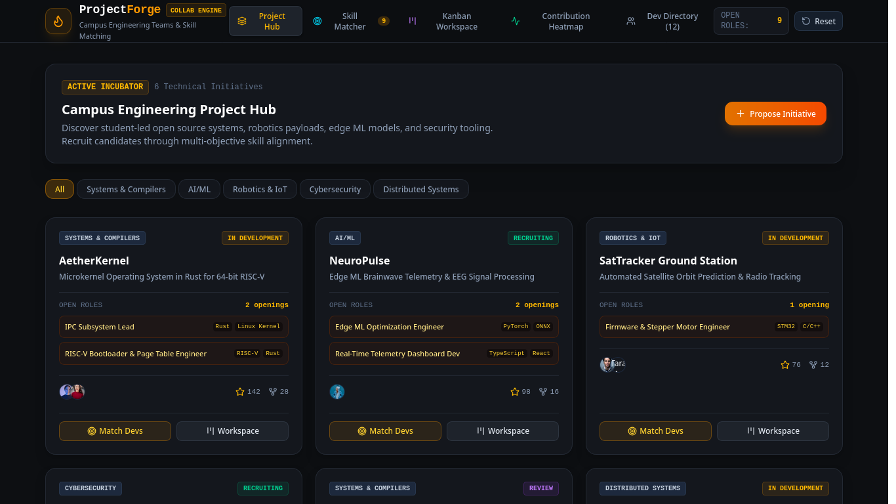

# ProjectForge — Technical Project Collaboration & Skill Matching

> High-velocity campus engineering incubator, deterministic multi-criteria skill matching engine, and in-browser Agile sprint workspace for student developers.



## Overview

University engineering students build complex technical projects—operating systems, edge ML telemetry pipelines, robotics firmware, vulnerability fuzzers, and P2P protocols. However, forming high-performance teams is often blocked by opaque skill alignment, mismatched bandwidth expectations, and fragmented sprint coordination.

**ProjectForge** provides a structured collaborative platform with an explainable, deterministic skill matching engine, full-lifecycle recruitment workflows, an interactive 5-column Kanban sprint workspace, and 52-week engineering contribution analytics.

---

## Key Features

- **Multi-Factor Skill Matching Engine**:
  - **Skill Coverage (50%)**: Evaluates percentage of required competencies fulfilled.
  - **Proficiency Fit (35%)**: Calculates competency ratio $\min(1.0, \text{level} / \text{required})$.
  - **Bandwidth Alignment (15%)**: Calibrates against candidate's available hours/week.
  - Transparent match percentages with visual indicators for matching strengths and missing prerequisites.
- **Bi-Directional Alignment**:
  - Match candidate developers to any target project opening.
  - Match open project roles to any student profile.
- **Project Discovery Hub**:
  - Filter across Domains: *Systems & Compilers*, *AI/ML*, *Robotics & IoT*, *Cybersecurity*, and *Distributed Systems*.
  - Project cards featuring open roles, team avatars, GitHub metrics (stars, forks), and status indicators (*Recruiting*, *In Development*, *Code Review*).
- **Interactive Kanban Sprint Board**:
  - 5 swimlanes: `Backlog`, `To Do`, `In Progress`, `Code Review`, and `Completed`.
  - Shift tasks across columns with one click.
  - Story point estimation, urgency classification, tags, and team member assignments.
- **52-Week Contribution Analytics**:
  - GitHub-style interactive heatmap displaying weekly commit cadence, PR throughput, and sprint velocity.
- **Talent Directory**:
  - Comprehensive profiles for 12 campus engineers featuring technical competencies, level ratings, and GitHub statistics.
- **Local Persistence & Instant Reset**:
  - All recruitments, new projects, and Kanban task movements persist in browser `localStorage` with a 1-click reset-demo-data option.

---

## Technical Stack

| Layer | Technology |
|---|---|
| Framework | React 19 + TypeScript |
| Build System | Vite |
| Styling | Tailwind CSS v4 |
| State Management | Zustand with Local Storage Persistence |
| Icons | Lucide React |
| Testing | Vitest |
| Matching Engine | Multi-Factor Client-Side Deterministic Algorithm |

---

## Getting Started

### Prerequisites

- Node.js $\ge 18$
- pnpm $\ge 8$

### Installation & Run

```bash
# Clone the repository
git clone git@github.com:Sanyam-Ahuja/projectforge.git
cd projectforge

# Install dependencies
pnpm install

# Start development server
pnpm dev

# Run Vitest test suite
pnpm test

# Build for production
pnpm build
```

---

## Matching Algorithm Architecture

$$\text{Total Score} = \left(0.50 \times \text{Coverage}\right) + \left(0.35 \times \text{Proficiency}\right) + \left(0.15 \times \text{Availability}\right)$$

Where:
- $\text{Coverage} = \frac{|\text{Matching Skills}|}{|\text{Required Skills}|} \times 100$
- $\text{Proficiency} = \frac{\sum \min(1.0, \frac{\text{Student Level}}{\text{Required Level}})}{|\text{Required Skills}|} \times 100$
- $\text{Availability} = \min\left(100, \frac{\text{Weekly Hours}}{15} \times 100\right)$

---

## License

MIT © 2026 ProjectForge. Built for Smart Campus & Student Life Portfolio.
